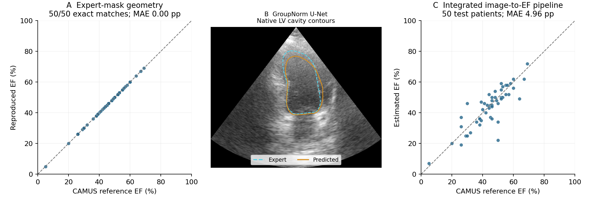

# LV Segmentation and Ejection Fraction Estimation

This project evaluates how left ventricular (LV) segmentation errors propagate
to ejection fraction (EF) estimates in CAMUS. Expert masks first establish
computational consistency with the publisher's volume calculation. A GroupNorm
U-Net then supplies predicted masks to the same calculation.



The official patient split comprises **400 training, 50 validation, and 50 test
patients**, with paired two- and four-chamber images at end-diastole and
end-systole. The selected checkpoint is included.

| Test-set measure | Result |
|---|---:|
| Expert-mask EF reproduction | **50/50 exact matches; MAE 0.00 pp** |
| Mean native-grid Dice | **0.9382** |
| Mean surface distance / HD95 | **1.40 / 3.70 mm** |
| Integrated EF MAE | **4.96 pp** |
| EDV / ESV MAE | **6.52 / 5.26 mL** |
| Patients with valid integrated estimates | **50/50** |

EF agreement concerns CAMUS's supplied rounded labels. Volume errors use volumes
derived from expert masks under the identical calculation. Here, pp denotes
percentage points.

## Contents and reproduction

- [Data setup](data/README.md): acquisition, patient splits, and native geometry.
- [Geometry reproduction](geometry/README.md): unchanged publisher functions.
- [Segmentation](segmentation/README.md): GroupNorm architecture, training, and inference.
- [Analysis](analysis/README.md): methods, results, and figures.
- [Reproduction instructions](docs/reproduction.md): dependencies and complete commands.

The saved code, checkpoint, tables, and figures can be checked without downloading
the images:

```bash
python -m analysis.verify
```

CAMUS: S. Leclerc et al., “Deep Learning for Segmentation using an Open Large-Scale
Dataset in 2D Echocardiography,” *IEEE TMI*, 38(9), 2198–2210, 2019.
[Paper](https://doi.org/10.1109/TMI.2019.2900516) ·
[Dataset](https://www.creatis.insa-lyon.fr/Challenge/camus/) · [Attribution and terms](NOTICE.md).
