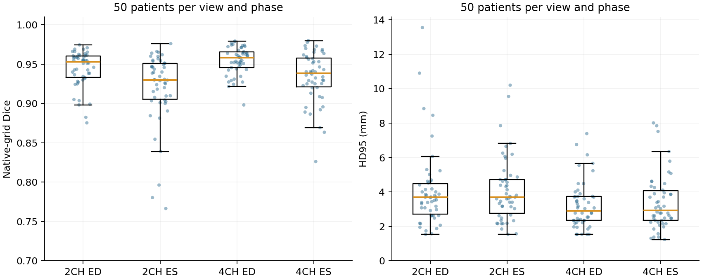
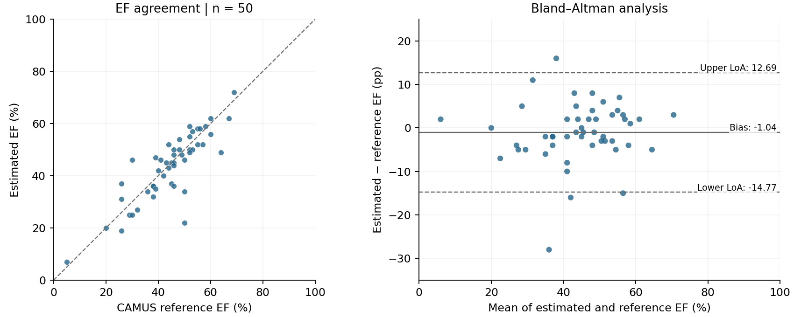
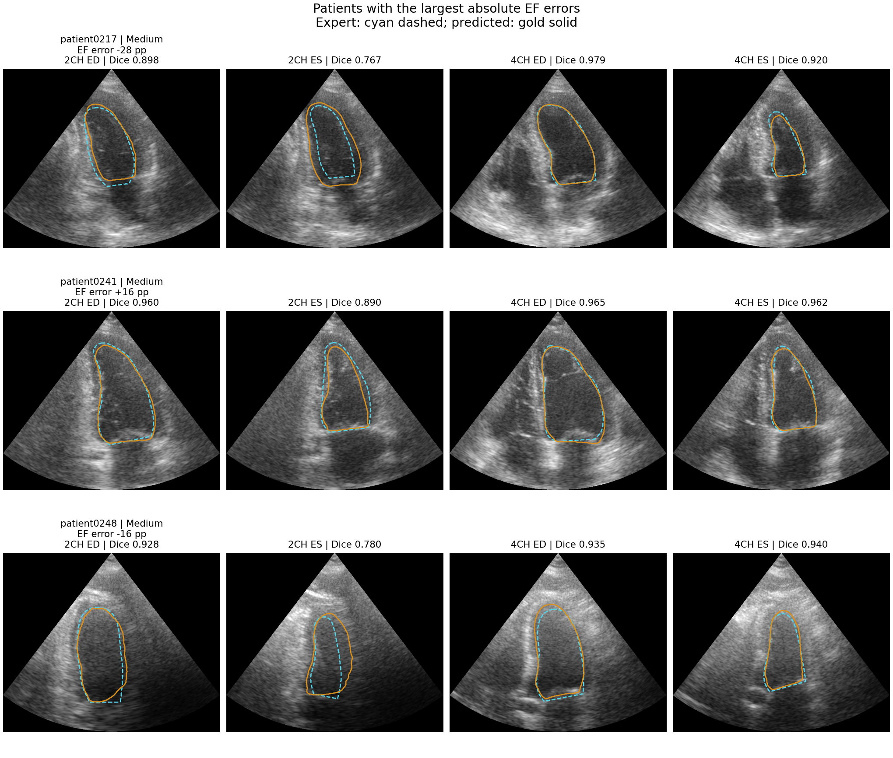

# Integrated evaluation

Evaluation follows the fixed sequence of native LV segmentation, paired volume
estimation, and EF calculation. Predicted and expert masks use the identical
publisher implementation, so their differences quantify the effect of replacing
expert contours with model predictions.

Segmentation is assessed using Dice overlap, average symmetric surface distance
(ASSD), and the 95th-percentile symmetric surface distance (HD95). Distances use
native pixel spacing. EF is compared with supplied rounded CAMUS labels; EDV and
ESV are compared with expert-mask-derived volumes. Bias is prediction minus
reference, and Bland–Altman limits are bias ± 1.96 sample standard deviations.
Confidence intervals use 2,000 patient-level bootstrap replicates with seed 523.

## Test results

All **50 patients and 200 frames** were evaluated. Mean Dice was **0.9382**
(95% CI 0.9322–0.9441), with mean ASSD **1.40 mm** and mean HD95 **3.70 mm**.

| View and phase | Mean Dice | ASSD (mm) | HD95 (mm) |
|---|---:|---:|---:|
| 2CH ED | 0.9442 | 1.52 | 4.08 |
| 2CH ES | 0.9204 | 1.59 | 4.10 |
| 4CH ED | 0.9546 | 1.21 | 3.22 |
| 4CH ES | 0.9338 | 1.29 | 3.39 |



EF MAE was **4.96 percentage points** (95% CI 3.72–6.54), with bias **−1.04 pp**,
limits of agreement **−14.77 to 12.69 pp**, and Pearson correlation **0.848**.
EDV and ESV MAE were **6.52 mL** and **5.26 mL**, respectively. All patients yielded
valid estimates; there were no empty predictions or geometry failures.



The lowest mean overlap occurred in 2CH ES. The largest absolute EF error was
28 pp in patient0217, whose 2CH ES Dice was 0.767. Patient0241 had patient-mean
Dice 0.944 but an EF error of +16 pp, illustrating that high average overlap can
coexist with a substantial functional error. All outliers remain in the analysis.



These findings describe one selected checkpoint on a single internal test
partition. The reference volumes are derived from expert masks, and subgroup
comparisons are descriptive. [Representative cases](../results/figures/prediction_examples.png)
are selected near the median absolute EF error within each image-quality stratum.

## Reusable outputs

[Frame measurements](../results/analysis/frames.csv),
[patient measurements](../results/analysis/patients.csv),
[view/phase summaries](../results/analysis/segmentation_metrics.csv), and
[EF/quality strata](../results/analysis/geometry_metrics.csv) support inspection
and reanalysis. Every figure is provided as PNG and SVG with source and artifact
hashes in the [figure manifest](../results/figures/figure_manifest.json).

```bash
python -m analysis.run
python -m analysis.figures
```
