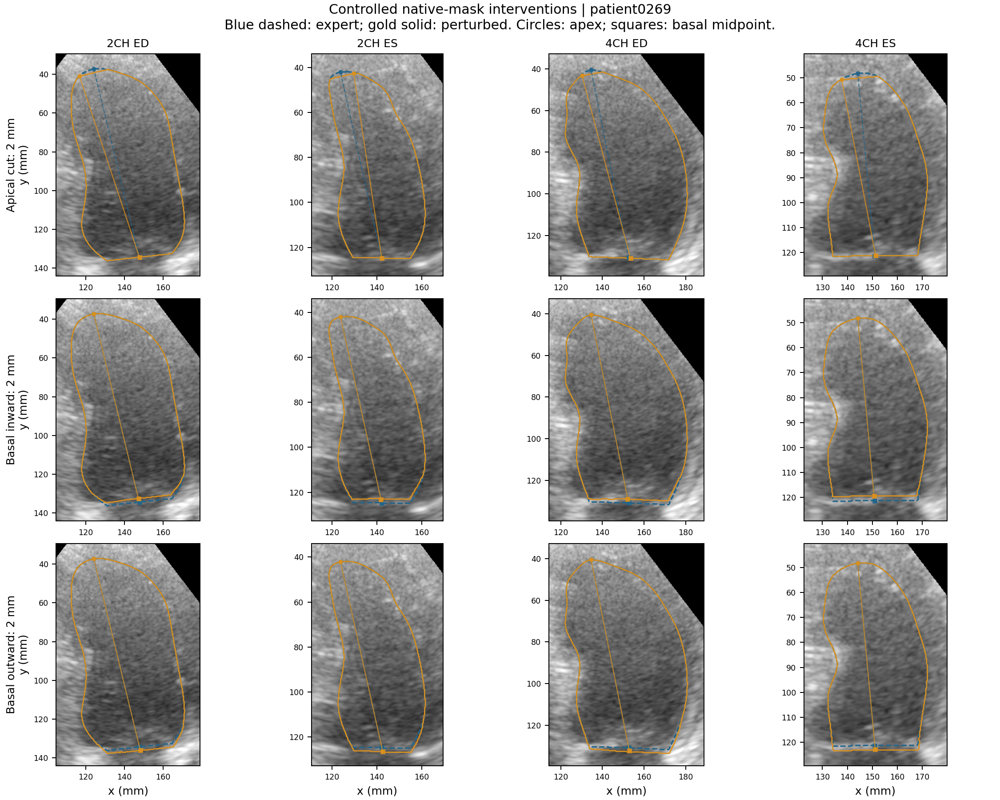
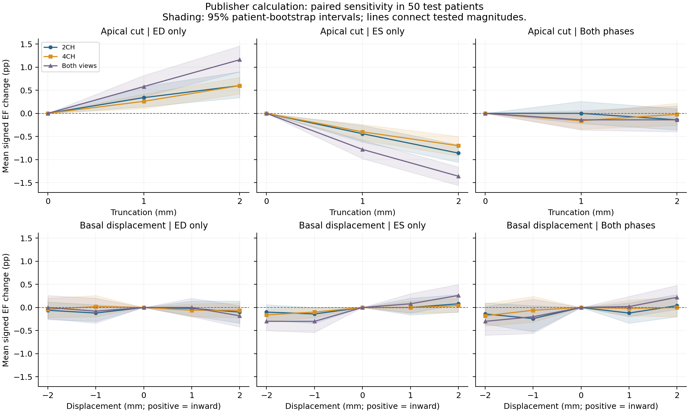
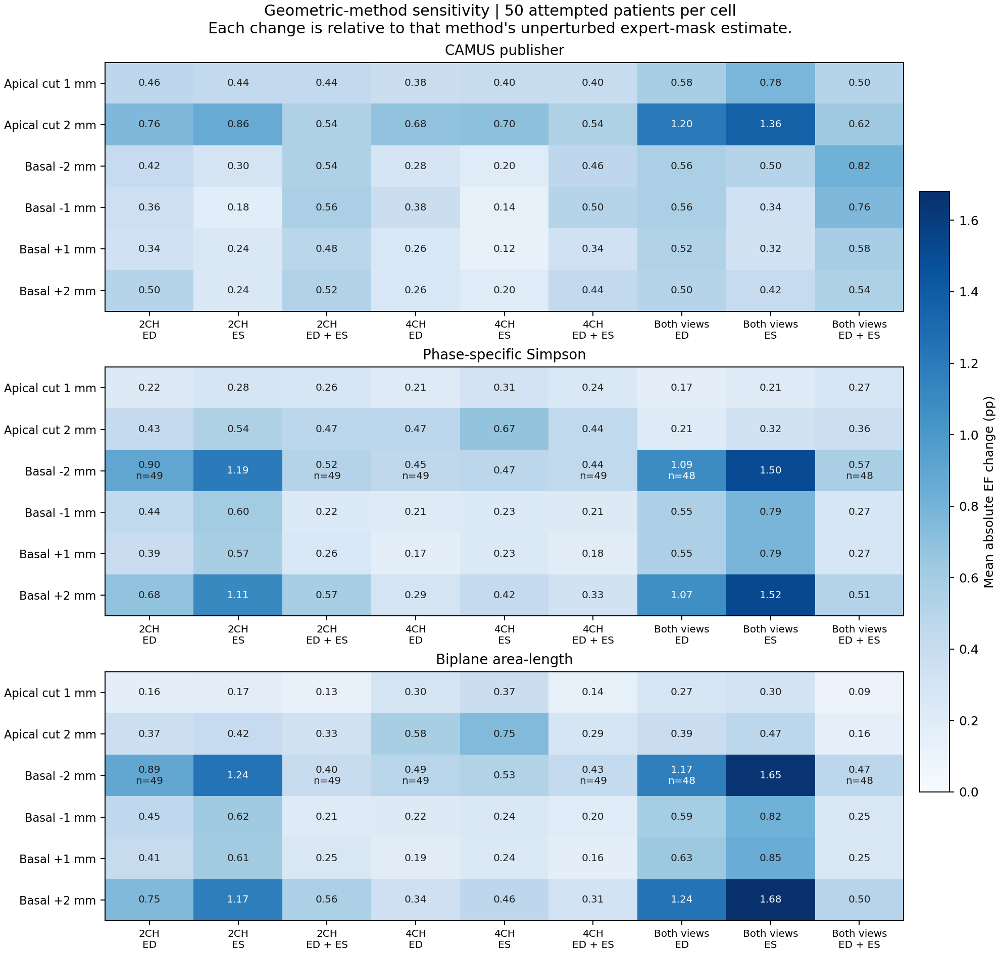
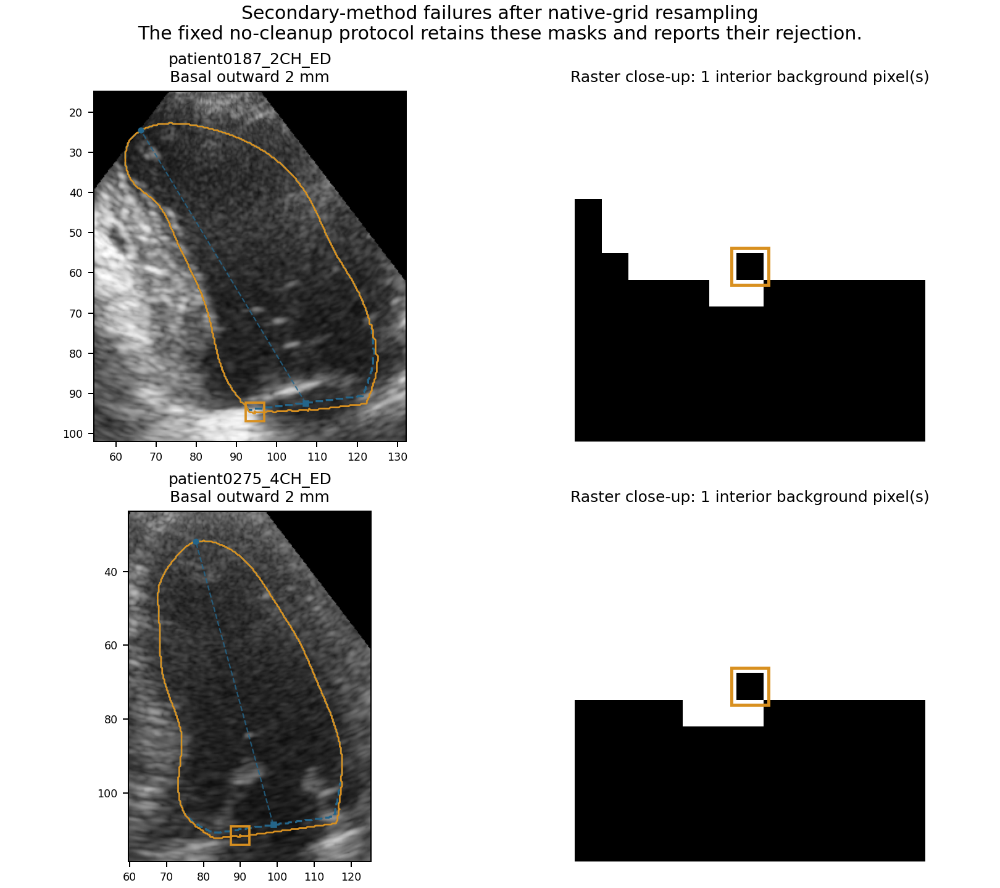
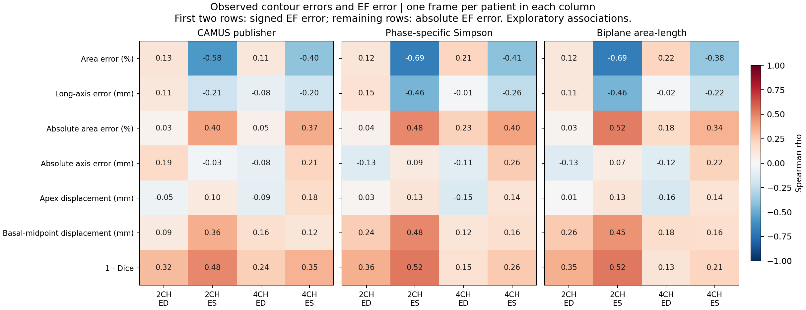
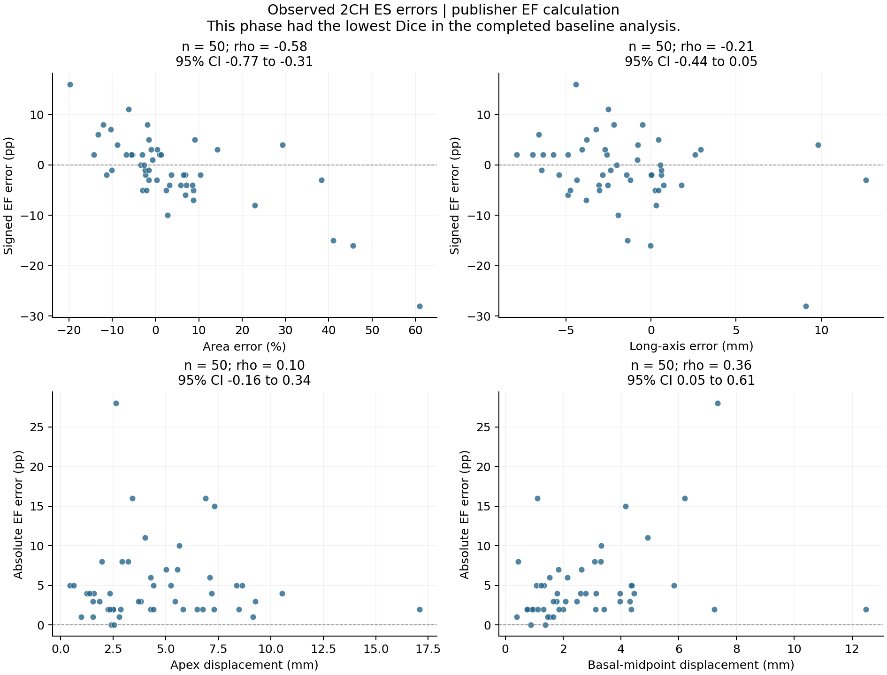
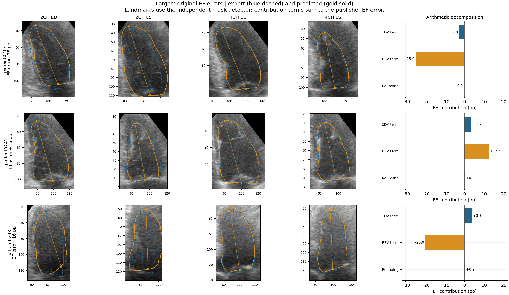

# Controlled contour errors and LV functional estimation

## Study design

This analysis completes the proposal's controlled error-propagation experiment.
The original 50 test patients, 200 native frames, and selected GroupNorm U-Net
remain fixed. Apical truncation (1 and 2 mm) and basal displacement (-2, -1, +1,
and +2 mm) were independently applied to expert masks in 2CH, 4CH, or both views
at ED, ES, or both phases. Positive basal displacement moves the boundary toward
the apex within a 10-mm tapering band. Interventions use native physical spacing
and a coordinate system derived from the original expert mask; geometry is
redetected after modification. The [protocol](../../docs/perturbation_protocol.md)
defines the deformation, rasterization, and all comparisons.

The 54 nonzero combinations and one shared control produce **8,250
patient-scenario-method evaluations** across three methods. Each change is
measured against the same patient's unperturbed mask under the same method.
The publisher calculation retains the original functions and rounding;
phase-specific Simpson and the explicitly defined biplane ellipsoid area-length
variant retain continuous measurements. Their comparison includes differences
in landmark detection, disk-height convention, sampling, and rounding, and
therefore is not an isolated comparison of integration formulas.

**Figure 1.** Native contours and mask-derived long axes for the patient closest
to median baseline patient-mean Dice. Each row applies its intervention
independently to the original mask. Basal midpoint and apex are marked by squares
and circles. Nominal displacement and measured landmark movement are distinct:
native rasterization and landmark redetection can alter the observed response.

## Baseline and geometric-method comparison

All **50/50** unchanged expert-mask EF
values reproduce the supplied rounded CAMUS labels. The observed segmentation
and geometric measurements reproduce the previous evaluation. Expert volume
references are derived from masks using the corresponding method.

| Method | Expert EF MAE vs CAMUS (pp) | Predicted EF MAE vs expert masks (pp) | Predicted EF MAE vs CAMUS (pp) | EDV MAE vs expert masks (mL) | ESV MAE vs expert masks (mL) |
| --- | --- | --- | --- | --- | --- |
| CAMUS publisher | 0.00 | 4.96 | 4.96 | 6.52 | 5.26 |
| Phase-specific Simpson | 7.09 | 5.10 | 8.33 | 6.21 | 4.93 |
| Biplane area-length | 7.30 | 5.11 | 8.26 | 6.59 | 5.14 |

The publisher result establishes computational agreement with CAMUS's rounded
labels. The secondary methods use different conventions; their direct CAMUS
errors include this baseline difference. Within-method predicted-versus-expert
comparisons measure the effect of replacing the expert contour with a prediction.

## Controlled sensitivity

Across all evaluations, **16 geometry failures**,
**0 invalid-volume results**, and
**0 border-contact results** were recorded. These
are counts of scenario-method evaluations, not independent patients. All 150
unchanged patient-method controls yielded zero volume and EF changes.
The table below reports the primary publisher calculation for perturbations
applied to both views. Signed changes are perturbed minus unperturbed; confidence
intervals use 2,000 paired patient bootstrap resamples. The complete view-specific,
method-specific, and subgroup estimates are retained in the result tables.

| Intervention | Affected phase | Mean delta EDV (mL) | Mean delta ESV (mL) | Mean delta EF [95% CI] (pp) | Mean absolute delta EF (pp) |
| --- | --- | --- | --- | --- | --- |
| Apical cut 2 mm | ED | +0.56 | -0.84 | +1.16 [0.90, 1.46] | 1.20 |
| Apical cut 2 mm | ES | -0.02 | +1.30 | -1.36 [-1.56, -1.16] | 1.36 |
| Apical cut 2 mm | ED + ES | +0.52 | +0.42 | -0.14 [-0.40, 0.16] | 0.62 |
| Basal inward 2 mm | ED | -2.14 | -1.16 | -0.18 [-0.42, 0.04] | 0.50 |
| Basal inward 2 mm | ES | -0.04 | -0.24 | +0.26 [0.06, 0.50] | 0.42 |
| Basal inward 2 mm | ED + ES | -2.16 | -1.52 | +0.22 [-0.04, 0.48] | 0.54 |
| Basal outward 2 mm | ED | +2.20 | +1.32 | +0.00 [-0.24, 0.26] | 0.56 |
| Basal outward 2 mm | ES | +0.06 | +0.30 | -0.30 [-0.50, -0.10] | 0.50 |
| Basal outward 2 mm | ED + ES | +2.28 | +1.62 | -0.30 [-0.60, 0.02] | 0.82 |

Apical truncation in both views produced opposite signed responses when applied
at ED and ES: the 2-mm intervention changed mean EF by
**+1.16 pp**
and **-1.36 pp**,
respectively. Applying the same cut at both phases reduced the mean signed change
to **-0.14 pp**,
while the mean absolute change remained
**0.62 pp**. Thus,
similar contour errors across phases can partially cancel in the EF ratio.

The estimated volume response need not follow the removed mask area. For the
2-mm cut in both ED views, estimated EDV increased in
24/50 patients, was unchanged in
21, and decreased in 5.
A [post hoc numerical audit](sampling_audit.json) of patient0027
reproduced this response with the complete original notebook: disk height fell
by 1.20%, while the sum of paired disk-diameter
products rose by 2.41%, changing rounded
EDV from 167 to
169 mL. This reflects redetection
and disk sampling in the estimator, not an increase in true cavity volume.

**Figure 2.** Signed EF responses to predefined physical perturbations under the
publisher calculation. Shading denotes 95% confidence intervals for the mean
paired response. Lines connect the tested magnitudes and do not imply a fitted
continuous response. The four-frame shared disk height can affect both volume
estimates after a single-phase intervention; integer rounding can also produce
plateaus or step changes.

**Figure 3.** Mean absolute within-method EF change. A common color scale supports
comparison across all methods. Absolute changes reveal responses that can cancel
in the signed mean. Means use available numeric pairs, with reduced sample sizes
marked in the affected cells. Paired differences between methods, with patient-bootstrap
intervals, are provided in [method contrasts](method_contrasts.csv).

The 16 rejected scenario-method evaluations originate from two single-pixel
interior holes introduced by nearest-neighbour basal deformation. Each affected
frame participates in four scenarios and both secondary methods. These are
digital rasterization failures under the fixed topology check, not evidence of
anatomical instability. The publisher method does not apply that rejection rule
and returned finite estimates in all 2,750 scenarios. Complete-case method
contrasts retain their paired sample counts; failures are never converted to
zero errors or silently repaired.

| Frame | Intervention (mm) | Rejection reason |
| --- | --- | --- |
| patient0187_2CH_ED | -2.00 | LV mask contains 1 hole pixels. No hole filling was applied. |
| patient0275_4CH_ED | -2.00 | LV mask contains 1 hole pixels. No hole filling was applied. |

**Failure audit.** Native contours and enlarged masks identify the two interior
background pixels. The main experiment retains the uncorrected masks.

For descriptive subgroup inspection, the following table fixes the intervention
at 2 mm in both ES views. Patient-level image quality is the poorer of the two
views. Each entry is mean absolute EF change in percentage points; confidence
intervals and all other scenarios are available in the complete summary.

| Stratum | Patients | Apical cut 2 mm | Basal inward 2 mm | Basal outward 2 mm |
| --- | --- | --- | --- | --- |
| EF >=55% | 10 | 1.30 | 0.50 | 0.50 |
| EF >45% to <55% | 17 | 1.18 | 0.41 | 0.53 |
| EF <=45% | 23 | 1.52 | 0.39 | 0.48 |
| Good | 17 | 1.29 | 0.35 | 0.47 |
| Medium | 23 | 1.43 | 0.52 | 0.61 |
| Poor | 10 | 1.30 | 0.30 | 0.30 |

## Observed segmentation errors

All prespecified associations use one observation per patient within each
view/phase combination. The first two rows below relate signed contour errors
to signed EF errors; remaining rows relate geometric discrepancy to absolute
EF error. Values are Spearman rank correlations for the publisher calculation.
All three methods and strata, including bootstrap intervals and undefined
estimates, appear in [the association table](associations.csv).

| Frame-level discrepancy | 2CH_ED | 2CH_ES | 4CH_ED | 4CH_ES |
| --- | --- | --- | --- | --- |
| Area error (%) | 0.13 | -0.58 | 0.11 | -0.40 |
| Long-axis error (mm) | 0.11 | -0.21 | -0.08 | -0.20 |
| Absolute area error (%) | 0.03 | 0.40 | 0.05 | 0.37 |
| Absolute axis error (mm) | 0.19 | -0.03 | -0.08 | 0.21 |
| Apex displacement (mm) | -0.05 | 0.10 | -0.09 | 0.18 |
| Basal-midpoint displacement (mm) | 0.09 | 0.36 | 0.16 | 0.12 |
| 1 - Dice | 0.32 | 0.48 | 0.24 | 0.35 |

In 2CH ES, area error was associated with signed EF error
(rho **-0.58**, 95% CI
**-0.77 to -0.31**).
The negative direction is consistent with larger estimated ES cavities producing
lower EF, although paired-view and ED errors also contribute. The weaker
landmark associations show that a single displacement measure does not capture
the full error pattern.

**Figure 4.** All 84 unstratified prespecified associations. Coefficients are
descriptive, with no significance-based selection or multiplicity-adjusted
confirmatory claim. Area and axis errors are signed in the first two rows;
the remaining features describe discrepancy magnitude.

**Figure 5.** Patient-level associations for 2CH ES, the lowest-Dice view/phase in
the completed baseline. The intervals resample patients and rerank ties within
each replicate. Association does not establish that a particular anatomical
error caused the EF deviation.

The largest baseline EF errors are retained below. An exact arithmetic
decomposition separates the EDV and ESV contributions, with a remainder for
final EF rounding. With expert volumes D and E and predicted volumes Dp and Ep,
the terms are `100*E*(Dp-D)/(D*Dp)` and `-100*(Ep-E)/Dp`. Their sum equals the
continuous EF difference; adding the recorded rounding remainder recovers the
reported EF error.

| Patient | Mean Dice | EF error (pp) | EDV term (pp) | ESV term (pp) | Rounding (pp) |
| --- | --- | --- | --- | --- | --- |
| patient0217 | 0.891 | -28.00 | -2.78 | -25.00 | -0.22 |
| patient0241 | 0.944 | +16.00 | +3.46 | +12.35 | +0.19 |
| patient0248 | 0.896 | -16.00 | +3.75 | -20.00 | +0.25 |

The ESV term has the largest magnitude in each of these three cases. In
patient0241, a mean Dice of 0.944 coexists with a +16-pp EF error, of which the
ESV term contributes +12.35 pp. Overlap accuracy alone therefore does not fully
describe functional agreement in this test set.

**Figure 6.** Expert and predicted contours with the independent mask detector's
landmark surrogates. These landmarks describe contour discrepancies and are not
the publisher's separate landmark calculation. The contribution terms explain
the EF arithmetic, not the anatomical cause of the volume errors.

## Interpretation and reproducibility

The experiment separates controlled contour sensitivity from the observed model
errors while preserving each method's baseline. It supports evaluation of which
regions, phases, and views affect the reported functional estimate. Absolute and
signed responses should be interpreted together because EDV and ESV errors can
reinforce or offset one another. Differences among methods reflect their full
declared computational conventions.

This is a descriptive analysis of one model and one 50-patient internal test
partition. The protocol was fixed after inspecting the baseline, and the
perturbations are simplified synthetic interventions. Small EF/quality strata
and multiple exploratory associations limit inference. Independent clinical
EDV/ESV and anatomical landmark annotations are unavailable. Zero expert-mask
EF error therefore establishes numerical reproduction, not independent clinical
accuracy. No test outcome was used to retrain the model or tune the protocol.

The package includes [patient/scenario results](patients.csv),
[frame intervention audits](perturbation_frames.csv),
[paired sensitivity summaries](sensitivity_summary.csv),
[observed frame measurements](observed_frames.csv), and
[observed patient measurements](observed_patients.csv).
The independent [validation receipt](validation.json) checks patient pairing,
coverage, unchanged controls, EF arithmetic, summary means, method contrasts,
rank correlations, and reproduction of the archived baseline.
See [reproduction commands](../../docs/reproduction.md#controlled-error-analysis).
