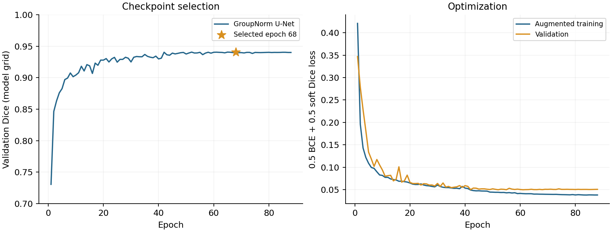

# LV segmentation

A single two-dimensional [U-Net](https://arxiv.org/abs/1505.04597) processes
grayscale images from both views and phases. Four downsampling stages use channel
widths 24, 48, 96, 192, and 384. Each double-convolution block contains
[Group Normalization](https://arxiv.org/abs/1803.08494) and ReLU activation; the
decoder uses transposed convolutions and skip connections. The model has
4,367,641 parameters and produces one LV-cavity logit per pixel.

Training uses 400 patients and an equally weighted combination of valid-pixel
binary cross-entropy and per-frame soft Dice loss. AdamW uses an initial learning
rate of 0.001, weight decay of 0.0001, and batch size 16. Augmentation jointly
transforms images, masks, and valid regions, with rotation, translation, scaling,
horizontal reflection, intensity variation, and additive noise. The complete
protocol is retained in [the configuration](configs/groupnorm.json).

Checkpoint selection uses mean validation Dice on 50 separate patients. Training
stopped at epoch 88; epoch **68** achieved the highest validation model-grid Dice
(**0.94084**). Test images and reference EF were excluded from optimization and
checkpoint selection.



During inference, probabilities are restored to the native image grid before
thresholding at 0.5. The largest eight-connected component is retained and
enclosed holes are filled. This fixed cleanup changed none of the 200 test masks.
Expert target arrays are not loaded during inference.

```bash
python -m segmentation.infer --device cuda
```

The [selected checkpoint](model_artifact/weights/best.pt), training history, and
original training metadata are retained together. Packaging preserved all
parameters and produced bitwise-identical logits, native probabilities, and
masks for every test frame; the [equivalence record](model_artifact/model_compatibility.json)
documents the model-source hashes and validation scope.
